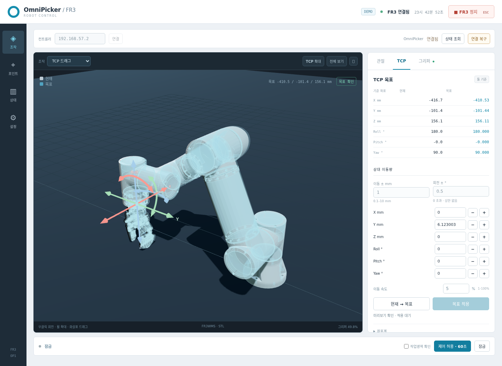
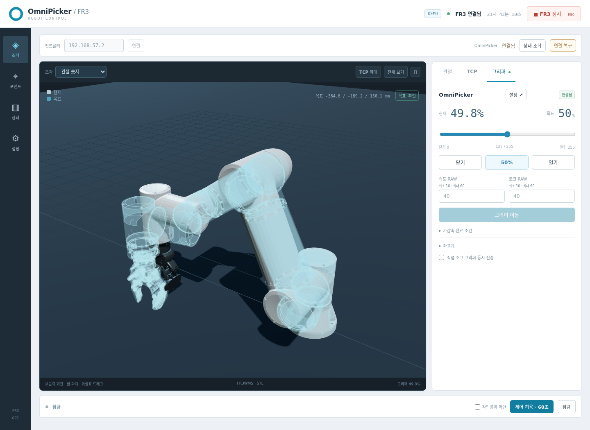

# OmniPicker FR3 Controller

FAIRINO FR3 로봇팔과 OmniPicker OP1 그리퍼를 제어하는 로컬 웹 UI 및 Python 통합 SDK입니다.



## 주요 기능

- 실제 제조사 STL/URDF 모델 기반 현재 자세·목표 쉐도우 표시
- 관절 회전 화살표와 TCP XYZ·Roll/Pitch/Yaw 연속 드래그
- 목표 좌표 즉시 표시, 컨트롤러 FK/IK 검증, 명시적인 목표 적용
- 관절 숫자 입력·조그, 속도 설정, 실제 관절 소프트 한계 검증
- FR3 컨트롤박스 RS485를 통한 그리퍼 위치·속도·토크·가감속 제어
- RS485 연결 진단·복구와 USB-C 전용 설정 창
- 포인트 저장·불러오기·JSON 가져오기/내보내기
- FR3 원본 SDK API 접근과 장치별 지원 기능 목록

## 실행

Python 3.10 이상을 사용합니다.

```bash
git clone https://github.com/pjs0209/OmniPicker_FR3_Controller.git
cd OmniPicker_FR3_Controller
python3 -m venv .venv
source .venv/bin/activate
python -m pip install -r requirements.txt
```

장비 없이 UI를 확인하려면:

```bash
python OmniPicker_FR3_Controller.py --demo
```

브라우저에서 **http://127.0.0.1:8088** 을 엽니다.

실장비는 제조사 FAIRINO Python SDK를 별도로 설치한 후 실행합니다.

```bash
python OmniPicker_FR3_Controller.py --ip 192.168.57.2 --slave-id 1 --sdk-path /path/to/fairino-sdk/linux
```

USB 설정 UI만 실행하려면:

```bash
python OmniPicker_Setting.py
```

USB 설정 UI는 **http://127.0.0.1:8089** 에서 열립니다. 통합 UI에서도 그리퍼 설정 창에 접근할 수 있습니다.

## 연결 구성

```text
PC ── LAN ── FAIRINO FR3 컨트롤박스 ── RS485 ── OmniPicker OP1
PC ── USB-C ── OmniPicker             (USB 전용 설정 시)
```

RS485 경로로 지원되는 기능과 USB/CAN 전용 기능을 구분합니다. 원본 FAIRINO SDK와 OmniPicker 제조사 SDK 바이너리는 이 저장소에 포함하지 않습니다.

## 사용·검증 범위

드래그와 숫자 편집은 목표 미리보기입니다. 실제 로봇 이동은 제어 허용 후 **목표 적용** 또는 직접 조그에서 실행됩니다. 연결 시 모터를 자동 활성화하지 않습니다. UI의 명령 잠금과 로봇의 서보 OFF는 서로 다른 상태입니다.

구현은 FR3 v3.9.8 / 제어기 V3.9.35-QX / OmniPicker 펌웨어 335의 RS485 경로를 기준으로 합니다. SDK 공개 API를 노출한다는 것이 모든 기능을 실장비에서 검증했다는 뜻은 아닙니다.

```bash
python -m unittest discover -s omnipicker_ui/tests -v
```

현재 86개 테스트가 포함되어 있습니다. 브라우저 QA는 전용 데모 서버에서 수행합니다. 장비별 실행 로그와 원본 위치·온도 피드백 파일, 캐시·인증정보는 업로드에 포함하지 않았습니다. 테스트에 필요한 고정 기구학 검증값은 포함됩니다.

## 문서

- [상세 실행·사용 설명](omnipicker_ui/README.md)
- [통합 SDK API](omnipicker_ui/SDK_API.md)
- [외부 모델·라이브러리 출처](THIRD_PARTY_NOTICES.md)


